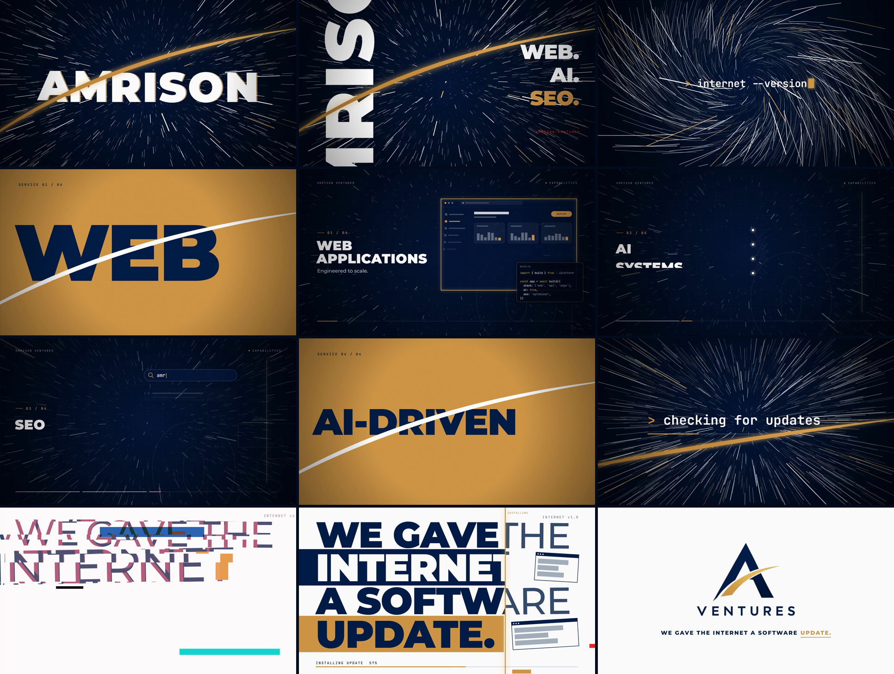

# We Gave the Internet a Software Update

**A 19-second brand ad for Amrison Ventures, built entirely in code and cut to the beat of a funk track.**



---

## The short version

Amrison Ventures builds web apps, AI systems and SEO. This repository is the ad that introduces them, and nothing in it was made in a video editor.

There is no After Effects project and no timeline. The whole ad is one JavaScript file that describes what the screen looks like at any moment in time. A script steps through the 19 seconds one frame at a time, takes a screenshot of each frame in a headless browser, and hands the frames to FFmpeg, which encodes them with the soundtrack into an MP4.

The result is a loud, fast, brutalist piece. It has a hyperspace starfield, oversized type, hard cuts on every bass hit, and a joke at the end: the internet is running an outdated version, and Amrison ships the update.

| | |
|---|---|
| **Length** | 19.000 seconds, 570 frames at 30 fps |
| **Formats** | 1920×1080 (16:9) and 1080×1920 (9:16), from one codebase |
| **Encoding** | H.264 video, AAC stereo audio |
| **Palette** | Navy `#031E48`, gold `#CF9648`, white `#FCFCFC`, with one red accent |
| **Stack** | JavaScript, Canvas 2D, Playwright (Chromium), FFmpeg |

## The idea

A typical tech-company ad shows laptops, gradients and a voice-over about "innovation". This project does the opposite, in three ways:

1. **The music drives everything.** The soundtrack is a funk track, and the ad is edited like a funk record: cuts land on the beat and type moves with the groove. The visuals were designed after the track was analysed, not before.
2. **The joke is the product.** The closing line, *"We gave the internet a software update."*, is acted out on screen. The type starts thin, crooked and glitching, labelled **INTERNET v1.0**. A gold scan "installs" the update: the glitches resolve, the type snaps to a heavy, strict grid, and interface panels lock into place. Then the logo lands as the punchline.
3. **The logo's gold swoosh is the thread.** The curve from the Amrison logo appears throughout: as the slash that opens the ad, as the line that cuts between scenes, as the wipe into the end card, and finally as the logo itself.

## How it was made

### 1. Audio first

Before any visual was designed, the soundtrack was measured: loudness in the bass, mid and treble bands, onset detection (where sounds start), and tempo, which comes out at about 122 BPM.

That produced a **cue map**, a list of timestamps for the strongest musical events:

- an opening impact
- four bass hits
- a breakdown where the energy drops about 15 dB
- a riser and a drop
- a second, louder lift
- four evenly spaced closing hits
- a final hit

The ad is a 19-second slice (3.40 s to 22.40 s) of a longer track. The slice starts in near-silence just before the first hit and ends on the track's own final hit, so the music is never cut off mid-phrase. Speed and pitch are untouched. The only processing is a 10 ms fade-in, a short fade-out and a clean gain reduction, because the decoded MP3 peaks above full scale and would clip when re-encoded.

### 2. Every frame is a function of time

The core of the project is one function, `renderFrame(t)`, which draws the frame at time `t`. It has no timers, no CSS animations and no `Math.random()`. Randomness comes from a seeded generator, so a given `t` always produces the same pixels.

This has three practical benefits:

- **Reproducible.** Re-rendering gives the same video.
- **Debuggable.** Any single frame can be rendered on its own, without playing the video up to that point.
- **Exact timing.** An animation tied to a cue at 4.03 s starts on frame 121, to the frame.

### 3. The render pipeline

```
 renderFrame(t)  ──►  Playwright + headless Chromium  ──►  PNG frames
                                                              │
                              soundtrack slice (WAV)  ──►  FFmpeg  ──►  MP4
```

A script (`scripts/render.js`) opens the page in Chromium, calls `renderFrame` for each of the 570 frames, captures a screenshot, and streams it to FFmpeg. FFmpeg encodes the video and adds the audio. No intermediate image files are written for a full render.

### 4. The logo is never redrawn

The official logo arrived as a compressed JPEG on a white background. A script (`scripts/prepare_logo.py`) removes the background with a soft colour-to-alpha key, so anti-aliased edges survive, and measures the logo's geometry, including the centreline of the gold swoosh. The animated swoosh in the ad follows that measured curve, so it lands exactly on the real one. The logo itself is only ever scaled uniformly.

### 5. Checking the result

A render succeeding does not mean the video is right, so the output was measured:

- **Specs:** resolution, frame rate, codec, duration and frame count were read back from the file. Video and audio are both exactly 19.000 s.
- **Audio:** the soundtrack in the final MP4 decodes bit-identically to the approved cut, with a true peak of −0.9 dBFS.
- **Sync:** the exported audio was analysed again, and visual cuts were compared against the cue map. The major cuts land on their beat to within a frame.
- **Frames:** contact sheets were made from the real output and inspected for spelling, alignment, contrast and stray artefacts.

## The 19 seconds

| Time | Musical event | What you see |
|---|---|---|
| 0.13 s | Opening impact | White flash. The gold arc slashes across and **AMRISON** flies out of the distance |
| 1.1–1.8 s | Four bass hits | A hard layout change on every hit: a cropped close-up, five rows sliding against each other, the word rotated down the edge, then full bleed |
| 2.1–3.6 s | Breakdown | The stars bank into a spiral while a terminal types `> internet --version` and answers **v1.0 [OUTDATED]** |
| 4.03 s | The drop | Four service scenes (web apps, AI systems, SEO, AI-driven solutions), each opening with a six-frame full-screen title slam |
| 11.06 s | Pre-lift | `> checking for updates…` over rushing stars |
| 11.77 s | The lift | The gold swoosh wipes the dark world away into white |
| 12.3–15.2 s | Statement | The closing line lands one word per beat, in the thin "outdated" look |
| 15.3–16.0 s | The update | A gold scan sweeps across: glitches clear, type turns heavy, panels snap into place, and the bar reads **UPDATE COMPLETE** |
| 16.62 s | Punchline | The official logo slams in on the beat |
| 18.56 s | Final hit | A glint crosses the swoosh and the end card holds as the music decays |

## Design language

- **Brutalist type.** Very large, very heavy lettering, often cropped by the frame edge, set in Montserrat Black. Words change scale abruptly instead of easing.
- **Depth.** The starfield is a real 3D point field with a camera that flies through it. Its speed pulses on the music, and its trails bend during the breakdown.
- **Two worlds.** The ad runs in navy, then in white. The dark half is the old internet and the pulse of the track. The white half is the daylight the logo was designed for.
- **Controlled glitch.** Smooth speed pulses carry most of the rhythm, while sharp glitch flashes (displaced slices, a red channel split, inverted blocks) are kept for the strongest accents only, each resolving within three frames.
- **Restraint with colour.** Navy, gold and white do almost all the work. A single red appears only in glitch hits and small status labels.

## Two formats from one codebase

The scenes are designed on a 1920×1080 canvas. Adding `?format=vertical` re-frames them for 1080×1920, with their own layouts wherever a tall frame needs it, such as the rotated title, extra rows in the repetition scene, stacked panels, a six-line statement stack and a two-line closing caption. Because both formats come from one timeline, a change to the timing updates both.

## Project layout

```
src/
  ad.js              the whole ad: cue map, scenes, effects and renderFrame(t)
  index.html         page that hosts the canvas
  versions/          earlier versions of ad.js
scripts/
  render.js          the Playwright to FFmpeg frame pipeline
  prepare-audio.js   cuts the soundtrack slice
  prepare_logo.py    logo cutout and geometry
  share.js           makes a small copy for chat and social
assets/
  brand/             official logo (original and cutouts) and measured geometry
  fonts/             Montserrat and JetBrains Mono, self-hosted
  audio/             soundtrack
docs/                storyboard images used in this README
```

## Running it

You need Node.js 20+, FFmpeg on your `PATH`, and Python 3.

```bash
npm install
npx playwright install chromium      # one-time browser download
npm run audio                        # cut the soundtrack slice
npm run render -- --out out/ad-16x9.mp4
npm run render:vertical -- --out out/ad-9x16.mp4
```

A full render takes roughly 7 to 10 minutes. To check individual frames without rendering everything, use `npm run stills -- 124,412,569`.

The cue times live in one object, `T`, at the top of `src/ad.js`, so retiming the ad means editing numbers in one place.

## Limitations

- **The cues belong to one track.** The animation is timed to this specific soundtrack. A different song needs its own analysis and a new cue map.
- **The logo source is small.** It is a compressed 828 px image shown at about 1.1× its native size, so a vector or high-resolution original would give a crisper end card.
- **Rendering is slow.** Capturing every frame in a browser guarantees identical output, but it is CPU-bound.

## Credits and licensing

- **Fonts:** Montserrat and JetBrains Mono, under the SIL Open Font License.
- **Logo and brand identity:** © Amrison Ventures.
- **Soundtrack:** third-party music, used for a non-commercial prototype. It is not licensed for redistribution or commercial use.
